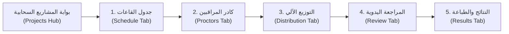

# منظومة التوزيع الذكي لمراقبي الامتحانات 🎓
### جامعة القدس المفتوحة — فرع الخليل | قسم الامتحانات
> **نظام ويب سحابي متكامل لأتمتة وتوزيع مراقبي الامتحانات بالذكاء الرياضي الإنساني ومراعاة راحة الكادر وعدالة الأنصبة**

---

## 🏛️ بطاقة تعريف المنظومة والاعتمادات الرسمية

| الحقل | البيان المعتمد |
| :--- | :--- |
| **المؤسسة الأكاديمية** | جامعة القدس المفتوحة — فرع الخليل |
| **القسم المسؤول** | قسم الامتحانات |
| **المساعد الأكاديمي المشرف** | الدكتور مراد الجندي |
| **إعداد وتصميم المنظومة البرمجية** | الأستاذ أحمد النتشة |
| **الرابط السحابي المباشر للإنتاج** | [https://qou-proctors.web.app](https://qou-proctors.web.app) |
| **مستودع الكود المصدري** | [qou-proctors-distribution (GitHub)](https://github.com/anatshih/qou-proctors-distribution.git) — الفرع `main` |
| **قاعدة البيانات السحابية** | Google Cloud Firestore (`projects/alnaseem-field-reports`) |
| **الفصل والدورة الحالية** | الفصل الدراسي 1261 — الامتحان النصفي |

---

## 📋 الأهداف الوظيفية للمنظومة

1. **تغطية قاعات الامتحانات بنسبة 100%:** أتمتة إسناد جميع شواغر القاعات (415 قاعة من أصل 415 قاعة) دون بقاء أي شاغر أو نقص.
2. **استيفاء أنصبة الكادر الأكاديمي بنسبة 100% (Difference = 0):** اعتبار النصاب الأكاديمي التزاماً تعاقدياً ملزماً يجب تحقيقه بالكامل دون أي عجز.
3. **عدالة ومرونة الكادر الإداري:** اعتبار نصاب الموظف الإداري سقفاً أقصى يتم التوزيع دونه بالعدالة والتوازن (89% إلى 100%) لحماية مهامهم المكتبية المعتادة وبحد أقصى جلستان يومياً.
4. **الاحترام الصارم للاستثناءات والاعتذارات:** تطبيق حظر مطلق على وضع المراقب في أي تاريخ أو جلسة اعتذر عنها مسبقاً.
5. **منع التعارضات الزمنية بنسبة 100%:** استحالة إسناد مراقب واحد في أكثر من قاعة لنفس الجلسة.
6. **مراعاة الراحة الجامعية:** تفادي الجلسات المفردة للأكاديميين، وحظر فجوة الجلسات (1 و 3 دون 2)، وتجميع المراقبات في أزواج ثنائية متتالية.

---

## 🧠 الخوارزميات والقواعد الرياضية المطبقة (Scheduling Engine)

تعتمد المنظومة على محرك جدولة مخصص متقدم متعدد المراحل يطبق القواعد التالية:

### 1. خوارزمية عنق الزجاجة أولاً (Bottleneck-First Scheduling)
* يتم فك جدول الامتحانات وحساب كثافة كل جلسة (عدد القاعات في كل جلسة).
* تُعطى الأولوية القصوى لجدولة أيام وجلسات الذروة الكبرى (مثل اليوم 12 واليوم 3 ذات الـ 21 و 25 قاعة) أولاً قبل استنزاف أرصدة المراقبين في الأيام الخفيفة.

### 2. قاعدة الأنصبة القليلة ➔ دوام في يوم واحد فقط (Low-Quota Compact Rule)
* الأساتذة ذوو الأنصبة المحدودة (مراقبتان أو 3 مراقبات) يتم تجميع مراقباتهم بالكامل في **يوم واحد فقط**:
  - **نصاب 3 مراقبات (مثل د. صالح الشلالفة، أ. لمياء عمرو):** يتم إسنادهم في يوم واحد متصل بثلاث جلسات متتالية `(1 + 2 + 3)`.
  - **نصاب مراقبتين (مثل د. خالد النجار، أ. نور القواسمي):** يتم إسنادهم في يوم واحد متصل بجلستين `(1 + 2)` أو `(2 + 3)`.
  - **النتيجة:** انتهاء نصاب الأستاذ في يوم حضور واحد طيلة فترة الامتحانات.

### 3. قاعدة التجميع الثنائي للأكاديميين (Pair-First Academic Clustering)
* يتم جدولة الأكاديميين في كتل ثنائية متتالية `(1 + 2)` أو `(2 + 3)` بحسب التفضيل المسجل وكثافة قاعات اليوم.
* هذا يمنع تشتت الأكاديمي ويضمن أن تكون كل أيام حضوره مجدية ومضاعفة لإنهاء نصابه في أقل عدد ممكن من الأيام.

### 4. قاعدة اليوم الثلاثي الذكي لأصحاب الأنصبة الفردية (Odd-Quota Triple Upgrade)
* الأساتذة ذوو الأنصبة الفردية (مثل د. عيسى المصري 13 جلسة، أ. مريم مسودة 15 جلسة، أ. أسماء شاهين 15 جلسة):
  - يتم تمكينهم من أخذ **يوم واحد فقط بـ 3 جلسات متتالية (1+2+3)** وباقي أيامهم ثنائية.
  - **النتيجة:** تصفير الأيام الفردية تماماً (0 أيام فردية) وتوفير يوم سفر وحضور كامل على الأستاذ.

### 5. الكادر الإداري كـ "ممتص للجلسات المفردة" (Administrative Shock Absorbers)
* في الأيام التي تشهد تفاوتاً حاداً في عدد القاعات بين الجلسات (مثلاً الجلسة 2 تتطلب 13 قاعة بينما الجلسة 3 تتطلب 4 قاعات فقط)، يمتص الكادر الإداري هذه الجلسات الفردية الفائضة بحكم تواجدهم المكتبي المعتاد في الحرم الجامعي دون الحاجة لتكبيد الأكاديمي مشقة الحضور لجلسة واحدة.

### 6. حظر فجوة (1 و 3) وسقف الجلسات اليومي:
* يُحظر تماماً إسناد الجلسة الأولى والجلسة الثالثة في نفس اليوم للأكاديمي مع ترك الجلسة الثانية فارغة.
* الكادر الإداري: الحد الأقصى الصارم هو **جلستان يومياً فقط** (لا يجوز 3 جلسات نهائياً).

---

## 🗂️ هيكلية المنظومة وخطوات العمل (The 5-Step Workflow)



### 0. بوابة المشاريع السحابية المركزية (Projects Hub)
- إدارة متعددة الفصول (مثل: فصل 1261 نصفي، فصل 1262 نهائي).
- إنشاء مشاريع جديدة، التبديل بين الدورات الامتحانية، والمزامنة السحابية المباشرة مع Firestore.

### 1. الخطوة الأولى: جدول القاعات والجلسات (Schedule Tab)
- استيراد وتفكيك جداول إكسل المعقدة مع المعالجة الذكية لأرقام تواريخ إكسل الرقمية (Excel Serial Dates).
- **الضبط المركزي الموحد لسعات القاعات:** إمكانية تحديد القاعات متعددة المراقبين (سعة 2 أو 3 مراقبين مثل مدرج الشهداء أو المختبرات).
- كشف التدقيق والمراجعة الشامل للقاعات والتواريخ جاهز للطباعة المباشرة.

### 2. الخطوة الثانية: كادر المراقبين وأنصبتهم (Proctors Tab)
- إدارة الكادر الجامعي (43 مراقباً مسجلين ومصنفين بدقة).
- الفصل الصريح بين **🎓 كادر أكاديمي (نصاب ملزم)** و **💼 كادر إداري (سقف أقصى)**.
- إمكانية التفعيل والتجميد وتعديل الأنصبة بضغطة زر.
- **نافذة الاستثناءات والاعتذارات الزمنية:** استثناء يوم كامل أو جلسة محددة بدقة.
- ميزة استبعاد الجلسة الثالثة وتحديد التتابع المفضل (1-2 أو 2-3).

### 3. الخطوة الثالثة: التوزيع الآلي الذكي (Distribution Tab)
- تشغيل محرك التوزيع الذكي واحتساب المقاييس والإحصائيات الفورية.
- زر **"🔄 إعادة التوزيع الآلي (بناءً على الأرصدة الحالية)"**.
- زر **"🗑️ تصفير وإلغاء التوزيع"** للرجوع لنقطة البداية مع رسائل التأكيد الاحترازية.
- مؤشرات بصرية حية لنسبة التغطية، عدد الجلسات الثنائية المتصلة، وتوازن الأنصبة.

### 4. الخطوة الرابعة: المراجعة والتعيين اليدوي (Review Tab)
- تصفح وتدقيق التوزيع يوم بيوم وجلسة بجلسة.
- إمكانية التعيين اليدوي والتبديل المباشر لأي قاعة أو شاغر مع توضيح رصيد كل مراقب (المنفذ / النصاب).

### 5. الخطوة الخامسة: النتائج والطباعة المعتمدة (Results Tab)
- **جدول القاعات والجلسات:** عرض كامل للقاعات والمراقبين مع خانات التوقيع المعتمدة للطباعة (A4).
- **بطاقات المراقبة الفردية:** فلترة حسب اسم المراقب وطباعة جدوله الشخصي لتوقيع اعتماده.
- **مصفوفة تفريغ المراقبين الشاملة المنسقة لطباعة A3 بالعرض (A3 Landscape PDF):**
  - مطابقة بنسبة 100% لملف الإكسل المعتمد `مصفوفة_تفريغ_المراقبين_1261_نصفي.xlsx`.
  - ترويسة مزدوجة (Two-tier Header): السطر العلوي للأيام والتواريخ، والسطر السفلي لأرقام الجلسات.
  - تثبيت عمود الأسماء (Sticky Column) عند التصفح والتمرير الأفقي على الشاشة.
  - إظهار حالة الاستيفاء لكل أستاذ وموظف، وتمييز القاعات المشتركة والاعتذارات.
- **نافذة التبديل السريع المباشر (Quick Swap Modal):** تبديل فوري بين مراقبين مع فحص التعارضات اللحظي.
- **تصدير إكسل:** تصدير جدول القاعات ومصفوفة التفريغ بملفات `.xlsx` منسقة وجاهزة.

---

## 🛠️ المتطلبات التقنية وبيئة التشغيل (Technical Stack)

```
├── Frontend Framework:    React 18.3+ (Single Page Application)
├── Build Tool:           Vite 5.4+ (Ultra-fast HMR & Bundler)
├── Styling Engine:       Tailwind CSS 3.4+ (RTL First, Cairo Font)
├── Icons:                Lucide React
├── Spreadsheet Engine:   SheetJS (xlsx v0.18.5)
├── Visual Effects:       Canvas Confetti
├── Database & Cloud:     Google Cloud Firestore (REST API & Local Sync)
├── Cloud Hosting:        Firebase Hosting (CDN Edge Network)
├── Version Control:      Git & GitHub (Main Branch)
└── Runtime:              Node.js v18+ / v20+ / v24+
```

---

## 💻 إرشادات التثبيت والتشغيل المحلي (Local Setup)

### 1. استنساخ المستودع وتثبيت الاعتماديات:
```powershell
# استنساخ المشروع من GitHub
git clone https://github.com/anatshih/qou-proctors-distribution.git
cd qou-proctors-distribution

# تثبيت الحزم والمكتبات
npm.cmd install
```

### 2. تشغيل خادم التطوير المحلي:
```powershell
npm.cmd run dev
```
افتح المتصفح على الرابط المحلي: `http://localhost:5173`

### 3. إجراء التدقيق البرمجي الشامل (55 فحصاً آلياً):
```powershell
node scratch/audit_app.cjs
```
> يُجري فحصاً شاملاً لسلامة الملفات، كادر المراقبين، خوارزمية التوزيع، ترويسات الجامعة الرسمية، وعدم وجود أي تعارضات.

### 4. بناء نسخة الإنتاج المجمعة (Production Build):
```powershell
npm.cmd run build
```
تُحفظ الملفات المصغرة والمجهزة داخل مجلد `dist/`.

---

## 🌐 النشر السحابي (Cloud Deployment)

### النشر على استضافة Firebase Hosting:
```powershell
npx.cmd firebase-tools deploy --only hosting
```
المشروع مربوط تلقائياً بـ `alnaseem-field-reports` وموقع `qou-proctors`، والمنظومة تُحدّث مباشرة على الرابط الرسمي:  
👉 **[https://qou-proctors.web.app](https://qou-proctors.web.app)**

---

## 📜 ضوابط الترويسات والتذييل والخصوصية

- **في كافة التقارير وكشوفات الطباعة (A4 و A3 PDF):**
  - **الترويسة الرسمية:** تقتصر حصراً على:  
    `جامعة القدس المفتوحة — فرع الخليل` / `قسم الامتحانات` (يُحظر وضع أي أسماء شخصية في الترويسة).
  - **التذييل والاعتمادات:** تظهر في أسفل الكشوفات الرسمية وشاشات المنظومة:  
    `جامعة القدس المفتوحة — فرع الخليل | المساعد الأكاديمي الدكتور مراد الجندي`  
    `إعداد وتصميم المنظومة: الأستاذ أحمد النتشة`

---

## 📞 الدعم الفني والتطوير
لأي استفسارات تقنية أو تحديثات برمجية، يتم التواصل مع مسؤول تطوير المنظومة:  
**الأستاذ أحمد النتشة** — جامعة القدس المفتوحة (فرع الخليل).
